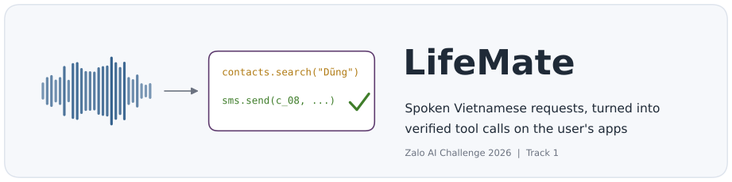
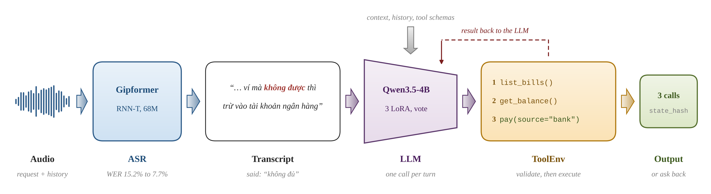

<div align="center">



<p>
  <a href="#results"></a>
  <a href="https://challenge.zalo.ai"></a>
  
  
  
  
  <a href="#docker-submission"></a>
  <a href="https://huggingface.co/hugebenevolence/lifemate-final"></a>
</p>

<p>
  <a href="#quick-start">Quick start</a> &nbsp;|&nbsp;
  <a href="#results">Results</a> &nbsp;|&nbsp;
  <a href="#reproduce-the-release">Reproduce</a> &nbsp;|&nbsp;
  <a href="#docker-submission">Docker</a> &nbsp;|&nbsp;
  <a href="docs/experiments.md">Experiment log</a>
</p>

</div>

LifeMate listens to a Vietnamese voice request and acts on the user's apps: it calls the right tools, in the right order, on
the organizer's `ToolEnv` sandbox, and it asks back or does nothing when that is the correct answer. This repository holds the
team's full solution to Track 1 of the Zalo AI Challenge 2026: inference, training, data pipelines, analyses and the offline
Docker image.

<p align="center">
  
</p>

## Highlights

- **61.26 on the public test**, from a 30.77 first baseline, with every model trained only on the organizer's TRAIN split.
- **Small and fast.** 4.31B parameters in total (limit 6B), about 3 s per request on one 24 GB GPU, fully offline.
- **Safe by construction.** Every proposed call is checked (schema, IDs seen before, no repeats, bounded retries) before it
  reaches the single `ToolEnv` of the sample, because every executed call is scored.
- **Reproducible end to end.** One script rebuilds all training data (checked byte for byte against the released data), one
  script retrains every checkpoint, and the released weights ship with SHA-256 sums.

## Contents

- [How it works](#how-it-works)
- [Results](#results)
- [Quick start](#quick-start)
- [Reproduce the release](#reproduce-the-release)
- [Evaluate a change](#evaluate-a-change)
- [Docker submission](#docker-submission)
- [Repository layout](#repository-layout)
- [Rules we follow](#rules-we-follow)
- [Acknowledgements](#acknowledgements)

## How it works

| Stage | What runs | Key choices |
| --- | --- | --- |
| ASR | [Gipformer 1.5](https://huggingface.co/g-group-ai-lab/gipformer1.5-68M-rnnt) (68M RNN-T), fine-tuned on all TRAIN audio, ONNX on CPU with sherpa-onnx | numbers spelled the way they are spoken; speed, noise and SpecAugment augmentation; word error rate 15.2% to 7.7% |
| Prompt | rules, read-only history, the request with its context | weekday calendar for relative dates; Vietnamese name and description of each installed app; hints for empty searches |
| LLM | [Qwen3.5-4B](https://huggingface.co/Qwen/Qwen3.5-4B) (text layers, non-thinking, greedy) + LoRA r16, served by vLLM | trained on replayed TRAIN trajectories with gold and ASR transcripts, loss only on the model's own decisions |
| Agent loop | one call per turn, at most 10 turns, on the sample's single `ToolEnv` | schema and `x-ref` checks, no identical call twice, a search that came back empty twice is blocked |
| Output | `env.get_tool_calls()` and `env.get_state_hash()` | a question back (`sys.ask_missing_info`) or an empty list are answers too |

An optional step-level vote of three adapters (`ENSEMBLE` in [`configs/release.sh`](configs/release.sh)) lets all three
propose each call and runs only the majority call on the same `ToolEnv`, which keeps the one-environment rule.

Every model and agent setting lives in [`configs/release.sh`](configs/release.sh); the local server, the local runs and the
Docker image all source it.

## Results

Scores are the organizer's metric (final state must match, then F1 of the calls), times 100. Validation is 200 frozen TRAIN
samples kept out of training ([`configs/splits/validation_ids.json`](configs/splits/validation_ids.json)); it runs about
13 points above the public test because every validation app also appears in training.

| Submission | Validation | Public |
| --- | ---: | ---: |
| Original Gipformer + Qwen3-4B LoRA (first baseline) | 36.4 | 30.77 |
| ASR text lower-cased | 44.0 | 38.80 |
| Fine-tuned Gipformer, trajectory SFT, no repeated calls | 60.0 | 48.18 |
| Qwen3.5-4B LoRA `e1` | 70.91 | 58.02 |
| `p1` recipe: E1P prompt, recovery rows, weighted loss | 69.55 | 57.65 |
| **Release: `p1` on all data + final ASR** | (trained on it) | **61.26** |

The release, run through the Docker image's code path ([`scripts/infer/docker_local.sh`](scripts/infer/docker_local.sh)) on
the 634 public samples:

| 634 public samples, one stream, one RTX PRO 4000 Blackwell (24 GB) | Value |
| --- | ---: |
| Model loading (vLLM start to ready) | about 45 s |
| Mean time per sample, ASR included | 2.88 s |
| Slowest sample | 8.71 s |
| Samples over the 30 s limit | 0 |
| Same final state as the submitted 61.26 file | 618 / 634 |

Greedy decoding is not bit-exact across runs in vLLM: batching (the 61.26 file used four parallel streams) and prefix-cache state
change a few low-margin choices. Two single-stream runs of the same 100 public samples agreed on 97; in the 3 others the model got
the identical prompt and picked a different amount at one turn. The Track 1 rules average five organizer runs in that case.

More numbers and every decision: [docs/experiments.md](docs/experiments.md), [docs/error_analysis.md](docs/error_analysis.md).

## Quick start

**Requirements:** Linux, one NVIDIA GPU with 24 GB, Python 3.12, [uv](https://docs.astral.sh/uv/), and the organizer kit in
`data/train+public_test/` (it is not redistributed here).

```bash
uv venv .venv --python 3.12 && uv pip install --python .venv/bin/python -e '.[infer,test]'
bash scripts/setup/get_models.sh       # Qwen3.5-4B and the original Gipformer, pinned revisions -> models/
bash scripts/setup/get_checkpoint.sh   # released checkpoints, checked against SHA256SUMS -> outputs/release/lifemate-final/

bash scripts/infer/serve.sh                                          # terminal 1: vLLM on 127.0.0.1:8000
bash scripts/infer/docker_local.sh public_test outputs/pub_release   # terminal 2: predict like the Docker image
```

`docker_local.sh` writes `outputs/pub_release/submission.jsonl` (one line per sample with `id`, `tool_calls`, `state_hash`,
`time`) and a trace of every turn in `outputs/pub_release/logs/trace.jsonl`. Check a file with the organizer's validator:

```bash
PYTHONPATH=data/train+public_test/public_test .venv/bin/python -m zaic_tools --split public_test \
  --root data/train+public_test --validate outputs/pub_release/submission.jsonl
```

| Download | Source |
| --- | --- |
| Base LLM | [Qwen/Qwen3.5-4B](https://huggingface.co/Qwen/Qwen3.5-4B) @ `851bf6e806efd8d0a36b00ddf55e13ccb7b8cd0a` (Apache-2.0) |
| Base ASR | [g-group-ai-lab/gipformer1.5-68M-rnnt](https://huggingface.co/g-group-ai-lab/gipformer1.5-68M-rnnt) @ `dd9227dcd8705c13f33bdbe59728d546ab94480f` |
| Released checkpoints | [hugebenevolence/lifemate-final](https://huggingface.co/hugebenevolence/lifemate-final): `asr-gipformer/`, `llm-lora-p1/`, `llm-lora-e1/`, `llm-lora-synth/`, `SHA256SUMS` |

## Reproduce the release

Two more environments are needed for training:

```bash
uv venv .venv-train --python 3.12 && uv pip install --python .venv-train/bin/python -e '.[sft]'   # LLM adapters
bash scripts/setup/setup_asr_env.sh                                                                # .venv-asr: torch 2.8, k2, icefall
```

Then three commands rebuild everything the release was trained on, retrain it and package it:

```bash
bash scripts/data/build_final_data.sh   # all training data, ~30 min on CPU
bash scripts/train/train_final.sh all   # ASR, then the adapters p1, e1, synth (~16 h on one 24 GB GPU)
                                        # ends with scripts/train/build_release.sh -> outputs/release/lifemate-final/
```

| Training set | Rows | Content |
| --- | ---: | --- |
| `outputs/asr_sft/asr_full` | 5,036 | every TRAIN recording with its transcript |
| `outputs/sft/data_full_p1` | 3,274 | E1P trajectories of all 1,545 tasks with gold and ASR transcripts, plus 92 recovery rows twice |
| `outputs/sft/data_full_e1` | 3,090 | E1 trajectories with gold and ASR transcripts |
| `outputs/sft/data_full_synth` | 3,746 | `data_full_e1` plus trajectories on synthetic apps, twice |

<details>
<summary>How a training trajectory is built</summary>

- The gold calls of a TRAIN sample are replayed in `ToolEnv`; every result must equal the label and the final call list must
  equal the gold list ([`scripts/data/prepare_agent_sft.py`](scripts/data/prepare_agent_sft.py)).
- The conversation uses the exact prompt and message format of inference.
- The "ASR copy" replaces the user's words (request and history turns) with the original Gipformer's transcript, so the model
  learns from real recognition errors on audio that ASR never trained on.
- Recovery rows ([`scripts/data/inject_recovery.py`](scripts/data/inject_recovery.py)) put a failed search (an honorific in the
  name, a misheard name, or an over-long query) before the right one. The failed search runs in `ToolEnv`, must return nothing,
  and carries no loss: the model learns the recovery, not the mistake.
- Loss falls only on the assistant turns (calls, arguments, the decision to stop), with weight 0.3 on free-text message fields,
  which the metric checks only loosely.

</details>

| Checkpoint | Settings (seed 42) | Time |
| --- | --- | ---: |
| `asr-gipformer` | all 68M parameters, 3 epochs, lr 2e-5, accum 4, number targets from their value, augmentation, last checkpoint | ~1 h |
| `llm-lora-p1` | LoRA r16 / alpha 32 on attention and MLP, 2 epochs, lr 1e-4, batch 1 x accum 8, max length 16,384, bf16 base, message weight 0.3 | ~5.6 h |
| `llm-lora-e1` | same LoRA on the 4-bit base (QLoRA), plain loss | ~4.3 h |
| `llm-lora-synth` | as `e1`, on `data_full_synth` | ~5.1 h |

Versions used for the released weights: `unsloth 2026.10.11`, `trl 1.15.0`, `peft 0.21.2`, `transformers 5.17.0`,
`torch 2.14.1` (LLM); `torch 2.8.0`, `k2 1.24.4`, icefall (ASR). The `sft` extra of [`pyproject.toml`](pyproject.toml) pins them.

## Evaluate a change

The released models were trained on every TRAIN sample, so they cannot be scored on the validation split. To test a change,
train the same recipe without the 200 validation tasks (drop `--include-validation` / `--final`) and compare on them:

```bash
.venv/bin/python scripts/infer/asr_cache.py --split train --ids configs/splits/validation_ids.json \
  --model-dir <asr folder> --output-dir outputs/asr/<name>_val
bash scripts/infer/run_shards.sh v200 configs/splits/validation_ids.json 4 asr sft            # ADAPTER, SERVED, CACHE override
bash scripts/infer/run_shards.sh v200_oracle configs/splits/validation_ids.json 4 oracle sft   # gold transcripts
.venv/bin/python analysis/score.py outputs/runs/v200 outputs/runs/v200_oracle
```

Validation predicts the public score for ASR and base-model changes, but not for changes in agent behaviour: 45% of public
requests use an app that never appears in TRAIN. Test those by hiding some TRAIN apps from training
([docs/experiments.md](docs/experiments.md), section 4).

## Docker submission

The image follows the organizer's guide: `/code/predict.sh` (no arguments) reads `/data/<split>` and writes
`/result/submission.jsonl` with a `time` field per sample, `/code/predict_notebook.ipynb` runs the same steps cell by cell for
timing, and `/code/training_code/` holds this repository. The image's README is [docker/README.md](docker/README.md).

```bash
TEAM=<team> bash docker/build.sh build    # needs Docker access and the NVIDIA runtime
TEAM=<team> bash docker/build.sh test     # predict.sh on the public test, --network none -> result_docker/
TEAM=<team> bash docker/build.sh export   # zac2026_<team>.tar.gz and its MD5
```

`build` streams only the code, the base LLM and `outputs/release/lifemate-final` into the build, with symlinks resolved. The
base image is `vllm/vllm-openai:v0.32.0`, within the organizer's CUDA 13.2 limit.

## Repository layout

```
configs/          release.sh (every model and agent setting), splits/validation_ids.json
src/lifemate/     agent loop and prompts, ASR, LLM client, step-level vote, ToolEnv access, Docker entry, CLI
scripts/setup/    base models, released checkpoints (download, upload), ASR training environment
scripts/data/     build_final_data.sh, trajectories, recovery rows, ASR pairs, synthetic apps, TTS text
scripts/train/    train_final.sh, LLM LoRA SFT, Gipformer fine-tuning and ONNX export, build_release.sh
scripts/infer/    vLLM server, sharded evaluation, ASR cache, submission merge, docker_local.sh, file comparison
analysis/         local scorer and the analyses behind the decisions
synth/            synthetic apps and tasks (training data of the synth adapter)
docker/           Dockerfile, predict.sh, flags.sh, predict_notebook.ipynb, start_jupyter.sh, build.sh, README.md
docs/             competition rules, experiment log, error analysis, dated reports, figures
tests/            python -m pytest (tests that need the kit skip without data/)
```

`data/`, `models/`, `outputs/` and `result/` are git-ignored.

## Rules we follow

- Only the TRAIN split is used for training. Public and private inputs are never labelled or trained on, and no prompt rule or
  check names an app that only appears in the test sets.
- One `ToolEnv` per sample, created once. App data is reached only through `validate`, `call`, `get_tool_calls` and
  `get_state_hash`; the environment files are never read.
- Inference is offline. Every base model is public and was released before 2026-10-26.

## Acknowledgements

Built on [Qwen3.5](https://huggingface.co/Qwen/Qwen3.5-4B), [Gipformer](https://huggingface.co/g-group-ai-lab/gipformer1.5-68M-rnnt),
[vLLM](https://github.com/vllm-project/vllm), [sherpa-onnx](https://github.com/k2-fsa/sherpa-onnx),
[icefall](https://github.com/k2-fsa/icefall), [Unsloth](https://github.com/unslothai/unsloth) and
[VieNeu-TTS](https://huggingface.co/pnnbao-ump/VieNeu-TTS-v3-Turbo) (TTS experiments). Thanks to the Zalo AI Challenge 2026 organizers
for the data kit and the `zaic_tools` sandbox.

Team: Dương Trường Bình, Tô Phát Đạt, Trần Đại Nhân.
